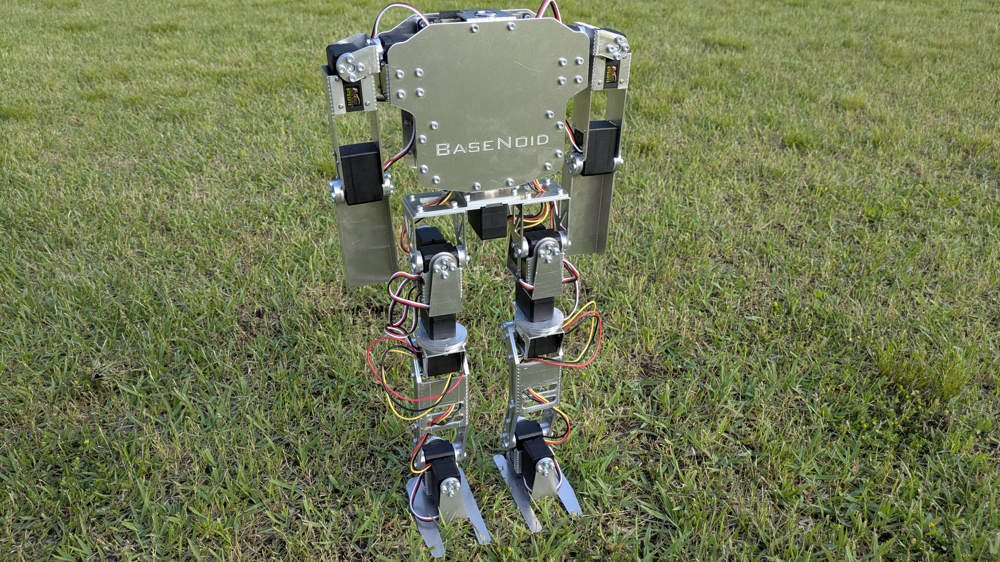

　BaseNoidは，初めてヒューマノイド製作を志す初学者が，ヒューマノイドの機械，回路，制御を一通り扱えるようになるためのプラットフォームとして開発された，教育用ロボットです．フィギュアの素体に着想を得て，以下の要件を満たすように開発しています．

- 安価に作成できること
- 製作者が容易に改造しやすいよう，脚部や腕部，胴部などが簡単に分離できる構造となっていること
- シリアルサーボモータやIMUなどの構成部品を使用することで，本格的なヒューマノイド制御理論を体験可能であること
- 部品はロボット技術研究会が所有するCNCフライスとベンダーのみで作成でき，旋盤など，製作者の経験が必要な工作機械は使用しないこと
- ロボット技術研究会の新入生が，短期間で製作できること

### BaseNoidの3D CAD

　BaseNoidの3D CADは，以下のGitHubリポジトリにて公開されています．

[GitHubリポジトリ - BaseNoid](https://github.com/Sugi-kmmm/BaseNoid)

### BaseNoidの制御回路

　BaseNoidでは，制御用基板としてACT Base Circuit（以下，ABC）という，ロボット技術研究会ACTで開発している多軸ロボット向け制御基板を用いています．
　ABCを使用しない場合は，[秋月電子通商様のSTS3215商品ページ](https://akizukidenshi.com/catalog/g/g116312/)内で紹介されている[参考資料](https://akizukidenshi.com/goodsaffix/feetech_digital_servo_20220729.pdf)の7ページ目をご確認の上，ご自分で回路を実装していただけましたら幸いです．
　ABCは，以下のGitHubリポジトリにて公開されています．
※ ABCは現在，β版の状態です．動作不良の可能性がありますので，ご了承ください．

[GitHubリポジトリ - ACT Base Circuit（β版）](https://github.com/TokyoTech-SSR-ACT/ACT_Base_Circuit/)

### BaseNoidのサンプルプログラム

　[Platform IO](https://platformio.org/)上でArduino Frameworkを用いてBaseNoidを制御するためのプログラムを開発しています．

[GitHubリポジトリ - BaseNoid Program](https://github.com/Sugi-kmmm/BaseNoid_Program)
