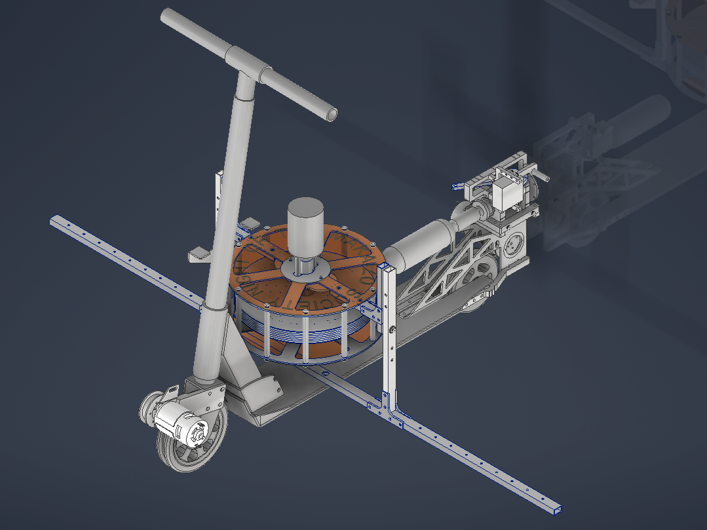

　この度，NHK番組「魔改造の夜」にて，[キックスケーター25m綱渡り](https://www.nhk.jp/p/ts/6LQ2ZM4Z3Q/episode/te/VR1G2K3NVK/)という競技に[チームＴ工大](https://www.nhk.jp/p/ts/6LQ2ZM4Z3Q/blog/bl/pVk9OkN7wJ/bp/pJk85g6m5B/)メンバーとして参加いたしました．キックスケーターを立たせ，しかも速く走らせるためにはどのような機構を搭載するべきか？　様々な試行錯誤と斎藤リーダーをはじめとした数多くのチームメイトの努力の結果，[Ho-Bird](https://www.nhk.jp/p/ts/6LQ2ZM4Z3Q/blog/bl/pOkgxAr3xO/bp/p1x6ELGGJn/)が完成いたしました．
　私はHo-Birdのジャイロスタビライザー（機体の真ん中にあったオレンジ色の樽のような部分）の設計を担当いたしました．ギリギリまで良いものが作れず，何日も眠れぬ夜を過ごしましたが，最終的にいいものが作れたと思っております．

　二度は体験できない貴重な体験でした．とても楽しかった！

　Ho-BirdのCADデータは，[こちら](https://x.com/titech_ssr/status/1763167927187222895)から回覧できます．
　また，映像は[NHKオンデマンド](https://www.nhk-ondemand.jp/goods/G2024134369SA000/)にて配信中です．ぜひご覧ください！

### NHK番組「魔改造の夜」とは？

　超一流のエンジニアたちが極限のアイデアとテクニックを競う技術開発エンタメ番組「魔改造の夜」。
　「子どものおもちゃ」や「日常使用の家電」がえげつないモンスターへと姿を変える。
　世界中でここにしかない、興奮と感動の夜会へようこそ！

※ [「魔改造の夜」公式サイト](https://www.nhk.jp/p/ts/6LQ2ZM4Z3Q/)より引用
