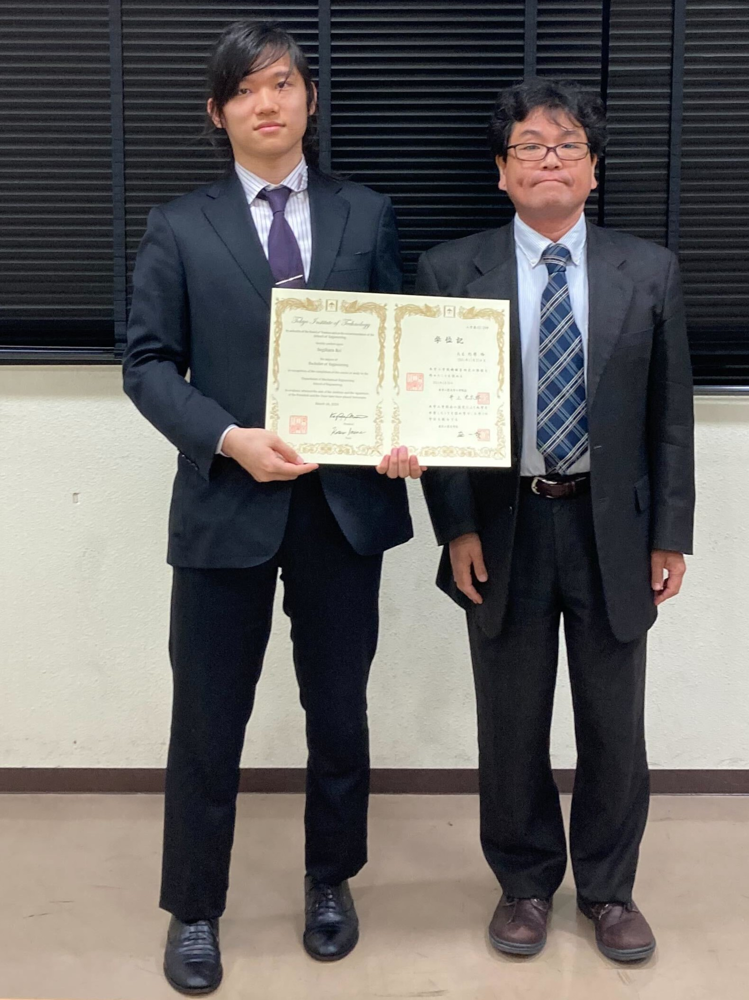

　この度，東京工業大学 工学院 機械系にて，学士（工学）を取得いたしました．所属研究室は[遠藤 玄 研究室](https://www.robotics.mech.e.titech.ac.jp/gendo/)で，学士特定課題研究タイトルは「ブリルアン光相関領域反射計によるオイラーのベルト理論の直接的可視化」でした．

　4月からは，[末包研究室](http://www.suekane.mech.e.titech.ac.jp/index-j.html)にて，引き続き研究活動に邁進いたします．
