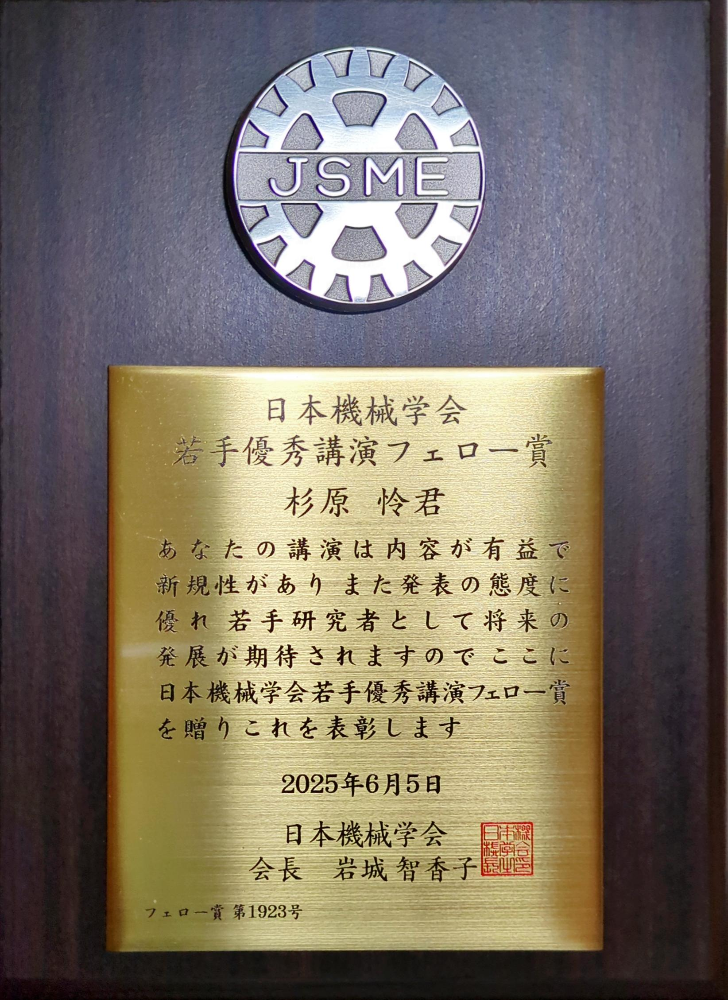

　この度，ロボティクス・メカトロニクス講演会2025において，日本機械学会若手優秀講演フェロー賞を受賞しました．この賞は、以下の講演が評価されたことによるものです．

**受賞講演**
1A1-L07
[ブリルアン光相関領域反射計によるオイラーのベルト理論の直接的可視化](/research/2024/2024robomech_1.html)
ROBOMECH2024

　当時指導教員の遠藤 玄教授をはじめとした，多くの共著者の皆様のご指導，ご協力による賜物であると強く感じております．
　引き続き，研究活動に邁進して参ります．
