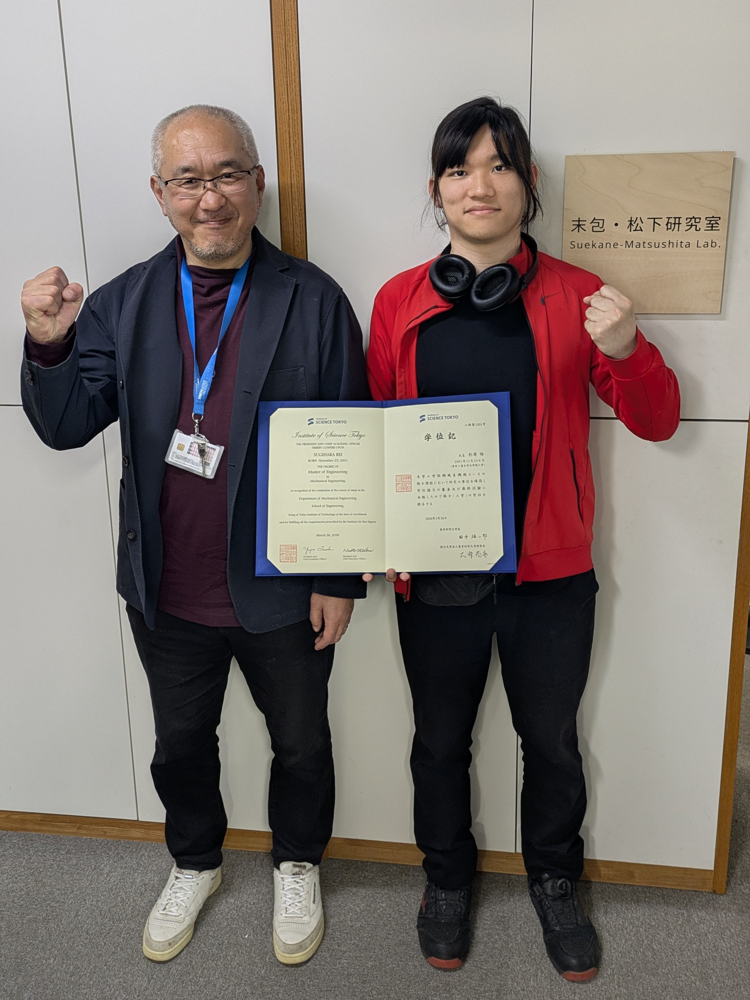

　この度，東京工業大学（現 東京科学大学） 工学院 機械系 機械コースにて，修士（工学）を取得いたしました．所属研究室は[末包・松下研究室](http://www.suekane.mech.e.titech.ac.jp/index-j.html)で，修士論文タイトルは「水酸化カルシウム攻法の原油増進回収メカニズム」でした．

　4月からは，[遠藤 玄 研究室](https://www.robotics.mech.e.titech.ac.jp/gendo/)にて，引き続き研究活動に邁進いたします．
